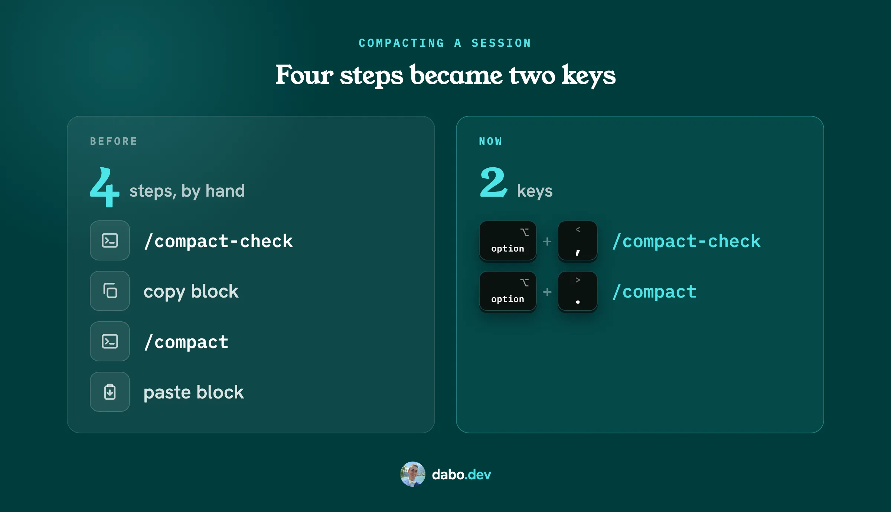
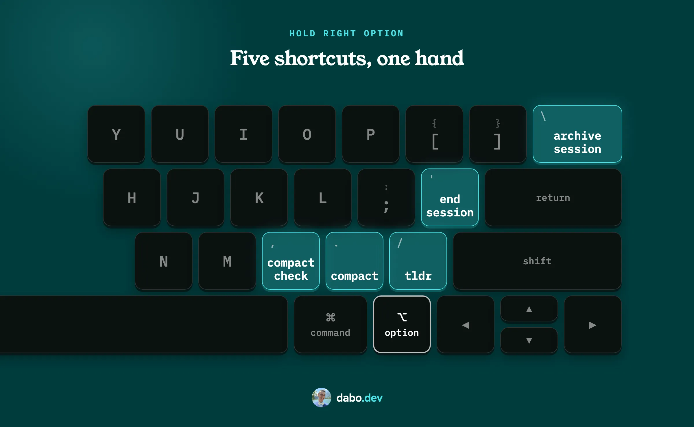
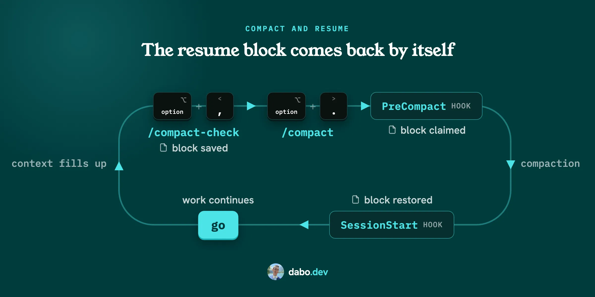

# Claude Code session workflow

Keep the plan when you run `/compact`, and never end a session with work that exists only in chat. Four slash commands, two hooks and five one-handed keyboard shortcuts. This is the setup I run every day.



## Install with one prompt

Paste this into Claude Code:

```
Read https://github.com/dabodamjan/claude-code-session-workflow and set it up for me by following its INSTALL.md.
```

Nothing is written before you see it. Claude runs `install.sh plan`, which lists every file it would create, update or leave alone, shows the diff of each update (long ones truncated) and the diffs of the hook entries it adds to `settings.json` and of the block it appends to `CLAUDE.md`, then asks before `apply`.

Every file it replaces is backed up first. Running the same install again changes no installed file and adds no second hook entry; only the manifest's timestamp moves. `install.sh uninstall` reverses exactly what the install recorded. [What uninstall covers](INSTALL.md#uninstall) · [Manual install](INSTALL.md#path-2-by-hand) · [Tests](tests/run.sh)

Needs macOS or Linux, `bash`, `jq`, `python3` 3.8 or newer and `git`; `gh` is optional. Works in the CLI, the VS Code extension and the desktop app.

## What you get



| You type | Shortcut (optional, macOS) | What happens |
| --- | --- | --- |
| `/compact-check` | Right Option + `,` | Checks the repo is safe to compact: working tree, push state, PR status, conflicts, the fast static checks, nothing left only in chat. Test suites are detected but not run. Green writes the resume block. Otherwise it lists the fixes, writes the files itself (a plan from chat, for example) and asks before any commit or push. |
| `/compact` | Right Option + `.` | Claude Code's own compact. A hook puts the resume block back. The shortcut then types `go` so Claude carries on; without the shortcut, type `go` yourself. |
| `tldr` | Right Option + `/` | Short, plain reply: 10 lines or 130 words, ending with what you still need to do. |
| `/end-session` | Right Option + `'` | Same check, higher bar: everything committed, pushed and in a PR, or listed for you to handle. Ends with a checklist and the links to merge. |
| `/archive-session` | Right Option + `\` | Archives the session once its PRs are merged. Desktop app only. |
| `/session-status` | | What this session is doing, in under 25 lines. Handy when several run at once. |

Right Option is the Option key to the right of the space bar. The shortcuts need Karabiner-Elements and a US layout; the commands work without them. The commit and push rules are in [includes/session-audit-core.md](includes/session-audit-core.md).

## What it looks like

`/compact-check` on a clean repo (names made up, output format real):

```
🟢 Safe to compact: clean tree, in sync, PR open, nothing in flight.

CWD          ~/code/my-app (matches git root)
Branch       feature/mailer-migration @ 05a0298
Working tree clean
Push state   in sync with origin
PR #12       OPEN "add: mailer migration"  https://github.com/you/my-app/pull/12
Conflicts    none (PR mergeable, no rebase/merge in progress)
Checks       tsc clean; lint clean; tests detected, not run
Dev server   none
Background   none
In-flight    none
Unwritten    none

Continuing from compacted session.

State:
- Repo: my-app @ feature/mailer-migration @ 05a0298
- PR: https://github.com/you/my-app/pull/12 ("add: mailer migration")
- Working dir: ~/code/my-app
- Plan: docs/plans/mailer-migration.md (read it fully, start at its RESUME block)

Last completed: stages 1 to 3 of the plan; stage 4 (cut over the queue) not started.

Next up: execute docs/plans/mailer-migration.md from its RESUME block.
```

On a repo that is not clean you get a fix plan instead. The command does the file edits itself and asks before it commits or pushes:

```
🟡 Compact with caution: 2 modified files and an unsaved 8-stage plan.

...
Fix plan:
1. Save the migration plan to docs/plans/mailer-migration.md (~40 lines).   [doing now]
2. Commit it with the two modified files: "add: mailer migration plan".      [needs your yes]
```

## How it works



`/compact-check` saves the resume block with a one-time marker. When you compact, a hook finds the block whose marker is in this session's own transcript and hands it back after the compaction, once. That is what keeps parallel sessions from picking up each other's plan. [docs/architecture.md](docs/architecture.md) has the hook-by-hook flow and the one edge case (`/branch`).

## Limits

- **Guided means approvals.** The install shows diffs and asks; it is not unattended. If a hook does not fire afterwards, restart the session.
- **`/archive-session` is desktop-only.** In the CLI, VS Code or a cloud session it says so and stops.
- **The shortcuts are macOS-only** and assume a US layout and an empty input line. I have verified the Escape-then-Enter sequence on the desktop app only. [Why they live in Karabiner](docs/decisions/001-shortcuts-live-in-karabiner.md)
- **Only manual `/compact`.** Auto-compact gets no resume block because nobody ran `/compact-check` before it.
- **Two things I have only observed on my machine, not found in the docs:** the session id stays the same across a compaction, and a `go` typed during a compaction is queued. [Documented versus observed](docs/architecture.md#documented-versus-observed)
- **The terse gate is best-effort.** It runs after the reply was shown and asks for a shorter one; it does not retract the first. To know you typed `tldr`, the stash hook (installed with `--terse-gate`) saves each prompt in a private file and deletes files older than a day whenever it runs. [How it works](docs/architecture.md#the-terse-gate)
- **The commands use the `commands/` file format**, the older one Claude Code still documents. If that changes, the four files port one-to-one.

## Prior art

- [claude-handoff](https://github.com/392fyc/claude-handoff): a `/handoff` command that writes a handoff document and a SessionStart hook that injects it into a *new* session. Explicit only, no PreCompact. This kit stays inside the same session and is gated on a repo audit.
- [A PreCompact snapshot with a SessionStart(compact) restore](https://zenn.dev/ryuka_lucas/articles/1e50ed03029b49?locale=en): saves recent messages automatically before compaction and injects them after. Automatic and content-based; this kit is deliberate and state-based, with a nonce that ties a block to the session whose transcript holds its marker.
- [anthropics/claude-code#11455](https://github.com/anthropics/claude-code/issues/11455): the feature request for a built-in handoff file.

## Who made this

Damjan Dabo, indie developer in Croatia. I build ReleaseRocket (release announcements drafted from GitHub tags, with my wife Sara as co-founder) and the iOS apps Itemlist, QRGenie and BarcodeCraft. I build in public and write at [dabo.dev](https://dabo.dev). Find me on [X](https://x.com/DamjanDabo) and [LinkedIn](https://www.linkedin.com/in/damjan-dabo/). I run Claude Code daily from the desktop app.

## License

MIT. See [LICENSE](LICENSE).
